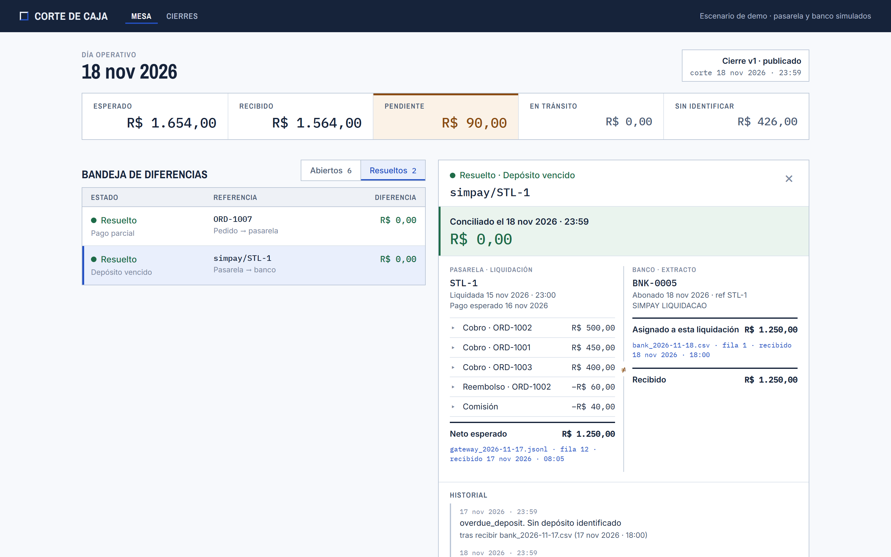
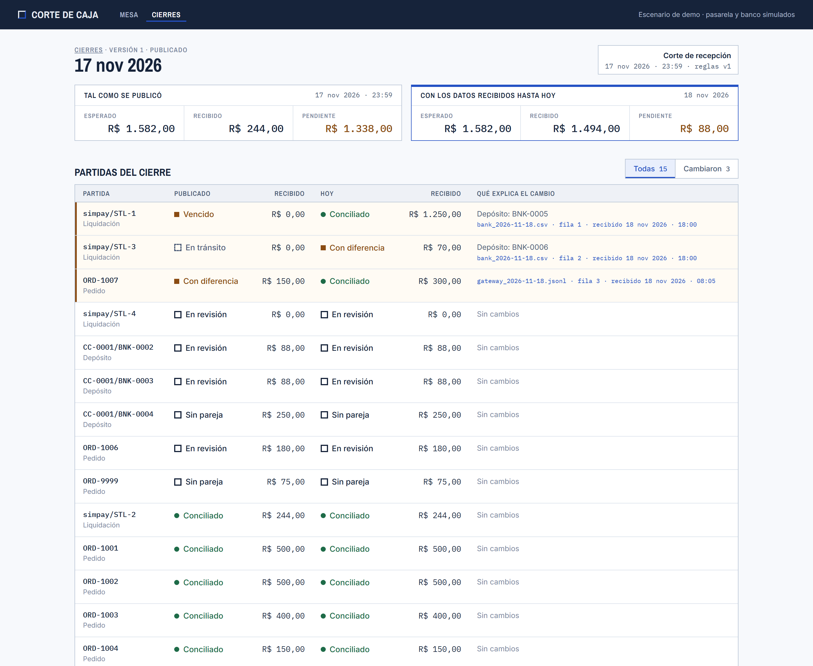
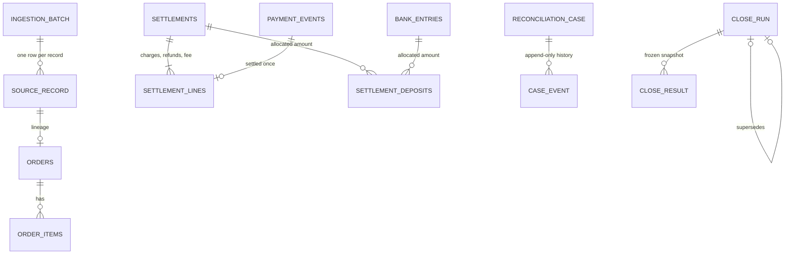

# Corte de Caja — daily cash reconciliation

[](https://github.com/saracastrillons/corte-de-caja/actions/workflows/ci.yml)

An operations tool that answers three questions at the end of every day:
**what money did we expect, what money arrived, and what is behind every difference?**

It reconciles an online store's orders against a payment gateway's settlements and the
bank statement, turns every difference into a case with evidence, and publishes a daily
close whose figures can be rebuilt row by row — including *what the team knew at the
moment it was published*.



> **Data provenance.** The demo uses a small, hand-written scenario with known answers.
> Order files follow the schema of the public [Olist e-commerce dataset](https://www.kaggle.com/datasets/olistbr/brazilian-ecommerce);
> the payment gateway ("SimPay"), fees, deposits, delays and injected errors are **simulated**.
> Currency: BRL only, exact decimals.

---

## The 3-minute demo

1. **Overdue.** On Nov 17 settlement `STL-1` is overdue: the gateway settled three charges
   (R$500 + R$450 + R$400), refunded R$60 and kept a R$40 fee — R$1,250 expected, nothing in the bank.
2. **Late deposit.** Nov 18's bank file arrives. The deposit is matched by reference, the case
   resolves itself and the history records *which file* resolved it and *when it was received*.
3. **Re-sent file.** The same statement is loaded again: it is recorded as `duplicate_file`
   and no balance moves.
4. **Time travel.** Open the Nov 17 close: *as published* it shows R$1,338 pending;
   *with today's data* only R$88 remain, and each changed row links to the file that explains it.
5. **Down to the source.** Any amount links to the exact row of the original file, with its
   SHA-256 fingerprint and reception time.



## Run it

```bash
docker compose up --build
```

Open <http://127.0.0.1:8000>. On first start the app migrates the database and plays the
demo story. To replay it from scratch locally: `python -m cortecaja.demo --reset`.

## How it works

```
CSV / JSONL files ──► raw (batches + every row as received, SHA-256 per file)
                         │  validation: bad rows kept with their reason
                         ▼
                      core (orders, items, payment events, settlements, bank entries)
                         │  recon.order_gateway()   order → gateway
                         │  recon.gateway_bank()    gateway → bank
                         ▼
                      ops  (cases + append-only history, closes + frozen results)
                         │
                         ▼
                      FastAPI + Jinja desk (read-only over the same SQL)
```

| Command | What it does |
|---|---|
| `python -m cortecaja.migrate` | Applies numbered SQL migrations once, with checksums |
| `python -m cortecaja.ingest <source> <file>` | Loads one file as a batch, validates, deduplicates |
| `python -m cortecaja.close <date> --cutoff … --publish` | Matches, updates the case inbox, publishes the close |
| `python -m cortecaja.demo [--reset]` | Plays the whole demo story |
| `uvicorn cortecaja.web.main:app` | The reconciliation desk |

## Data model

Every table states what **one row** means before any query is written.



| Schema | Tables | One row is… |
|---|---|---|
| `raw` | `ingestion_batch`, `source_record` | a received file; a record exactly as it arrived (JSONB) |
| `core` | `orders`, `order_items`, `payment_events`, `settlements`, `settlement_lines`, `bank_entries`, `settlement_deposits` | one business fact, keyed by its source identity, with `src_batch_id`/`src_row` lineage |
| `ops` | `reconciliation_case`, `case_event`, `close_run`, `close_result` | a difference someone must act on; something that happened to it; a close version; an item as published |

Three different clocks are kept apart: **when it happened** (`occurred_at`, `booked_on`),
**when we learned it** (`received_at`) and **when it was published** (`published_at`).
That is what lets the app answer both *"what do we know today about Nov 17?"* and
*"what did we know when we closed Nov 17?"*.

## The SQL worth reading

- **No fan-out.** An order with 3 items and 2 payments joined naively gives 6 rows and
  doubles both totals. Each side is aggregated to the order level *before* joining
  ([`sql/examples/01_fanout_trap.sql`](sql/examples/01_fanout_trap.sql) shows the wrong and the right way;
  a test fails if anyone reintroduces it).
- **Both sides of the gap.** `FULL OUTER JOIN` over pre-aggregated sets keeps orders without
  charges *and* charges without orders. Gateway ↔ bank is many-to-many, so each side is
  classified at its own level and stacked with `UNION ALL` instead of being forced into one row.
- **Explicit rule priority.** `CASE WHEN` ordered from most to least specific
  (duplicate charge before overcharge, ambiguous before overdue).
- **Window functions.** `LAG()` flags a second identical charge within 15 minutes.
- **As-of queries.** Every reconciliation function takes a reception cutoff, so the same
  query rebuilds the past.
- **The database enforces the rules.** Sign checks on settlement lines, one open case per
  entity (partial unique index), append-only history (trigger), no published close with a
  missing source (check constraint).

## Ingestion guarantees

| Situation | Result |
|---|---|
| Same file sent twice | Second batch stored as `duplicate_file`; nothing else changes |
| Same event inside a different file | Counted once (`ON CONFLICT … DO NOTHING`, then compared) |
| Same ID, different amount | Both observations kept in `raw`; a `data_conflict` case opens; nothing is overwritten |
| Malformed row | Stored with its rejection reason; the rest of the file loads |
| Wrong header / empty file | Batch marked `failed` |
| Bank statement missing for the day | Close is `incomplete` and does not replace the last published version |
| Two deposits with the same amount and date | Suggested, never auto-matched: a person decides |

## Tests

```bash
pytest -v
```

20 tests, each one a hand-written expectation: re-processing the same statement, the same
event in two files, conflicting IDs, the 3-items × 2-payments trap, a late deposit that
resolves a case while the old close stays reproducible, ambiguous deposits, a missing
statement, and one test per rule learned from real data (rounding tolerance, vouchers vs.
duplicate charges). Every test gets a fresh database cloned from a migrated template.
CI runs them on PostgreSQL 18 and applies the migrations twice.

## Volume & performance

Run against the full Olist dataset (99k orders, 113k items) plus a seeded gateway and bank
simulator that injects known errors — details in [docs/performance.md](docs/performance.md).

| | |
|---|---|
| Rows loaded | 320,891 in ~6 min (batched; 19 min row by row) |
| One daily file | 0.18 s median |
| Close over the whole period | 101,155 items in 13.2 s (223 s before batching) |
| Settlements reconciled automatically | 97.3 % |
| Classification vs. the simulator's answer key | 1,668 / 1,668 · **0 false reconciliations** |
| Open cases after learning from real data | 1,751 → 1,214 (rules v2) |
| Conflict-evidence lookup with an expression index | 70.7 ms → 0.095 ms |

```bash
python -m cortecaja.simulate && python -m cortecaja.volume

## Stack

PostgreSQL 18 · Python 3.14 · psycopg 3 · FastAPI + Jinja · plain CSS
(Archivo Narrow, Inter, IBM Plex Mono) · Docker Compose · pytest · GitHub Actions

## Roadmap

- Resolve ambiguous matches from the desk, with a mandatory reason recorded in the case history.
- Allocate one deposit across several settlements when the bank statement includes a breakdown.
- Incremental close: recompute only the items touched by the new files instead of the whole period.